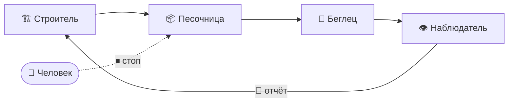

# 💡 Идея: Security Loop

> Бесконечный цикл «построй песочницу → попробуй сбежать → залатай дыру», который крутится, пока человек сам не скажет «хватит».

## Суть

**Security Loop** — платформа, которая запускает скилл в непрерывном цикле и с каждым кругом делает песочницу (sandbox) надёжнее.

1. Один ИИ-агент **строит песочницу**.
2. Другой ИИ-агент оказывается **внутри** неё с одной задачей: *выбраться любыми способами*.
3. Третий ИИ-агент **наблюдает** со стороны: фиксирует, как именно агент выбрался, и составляет отчёт.
4. Отчёт уходит **строителю** — он латает найденную дыру.
5. Агент снова отправляется в обновлённую песочницу — и всё повторяется.

Цикл не завершается сам по себе. Его останавливает только человек.

## Роли

| Роль | Задача |
| --- | --- |
| 🏗 **Строитель** | Создаёт песочницу и закрывает найденные дыры |
| 🥷 **Беглец** | Пытается выбраться из песочницы любыми доступными способами |
| 👁 **Наблюдатель** | Следит за беглецом, фиксирует путь побега и пишет отчёт для строителя |

## Ключевые решения

- **Роли — это скилы.** Каждая роль оформлена как отдельный скилл, а общий скилл описывает общую задачу и связывает роли в цикл.
- **Своя модель на каждую роль.** Пользователь сам выбирает, какая модель играет строителя, беглеца и наблюдателя.
- **Универсальность.** Скилл работает в разных агентных клиентах:
  - Claude Code
  - Codex
  - Hermes
  - OpenCode
- **Человек — единственный, кто останавливает цикл.** Отсутствие находок — не повод остановиться, а сигнал попробовать новую стратегию атаки.
