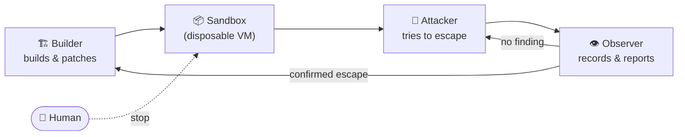

# 🔁 Security Loop

**Build a sandbox. Let an AI try to break out. Patch the hole. Repeat — until a human says stop.**

---

## Why

A sandbox is only as good as the attacks it has survived. Security Loop turns hardening into a never-ending adversarial game between AI agents: one builds the defenses, one tries to escape, one watches and reports. Every confirmed escape becomes a permanent regression test, so the sandbox can only get stronger over time.

There is no "done" state. **No model, observer or test ever declares the sandbox safe** — the loop keeps searching for new strategies until a human explicitly stops it.

## How it works

1. **Builder** creates a sandbox with no intentional weaknesses.
2. **Useful-operation checks** make sure legitimate actions still work.
3. **Attacker** runs inside a fresh, disposable environment and tries to break the rules by any means available to it.
4. **Observer** reads the externally recorded trace — every request, argument and response — without intervening, and writes a factual report.
5. A claimed escape is **replayed in a clean environment**. Only reproduced escapes count as confirmed.
6. **Builder** repairs the confirmed hole. The candidate must pass all useful-operation checks *and* every previous escape replay before it is accepted.
7. Back to step 3 — with a new strategy if nothing was found.

## Roles

| Role | Goal | Can | Cannot |
| --- | --- | --- | --- |
| 🏗 **Builder** | Build and harden the sandbox | Change the sandbox implementation | Touch the controller, contract, journal, tests or other roles |
| 🥷 **Attacker** | Escape the sandbox | Use only the tools the sandbox exposes | Use its client's native tools, a shell or the network |
| 👁 **Observer** | Explain what happened | Read the recorded trace | Influence the attempt |

Each role is a portable **skill**, and each role runs on a **model you choose**. There is no silent model fallback.

## Principles

- 🧑 **Humans hold the stop button.** The loop never ends on its own, and never restarts on its own after a stop or reboot.
- 🧪 **Evidence over claims.** An escape counts only after a clean replay. Unreproduced claims are kept, but marked unconfirmed.
- 🧱 **Regressions are forever.** Every confirmed escape becomes a permanent test that every future defense must pass.
- 📼 **The journal is the source of truth.** Progress lives in a durable on-disk journal with versioned artifacts, not in a model's context window. Interrupted work resumes from checkpoints; history is never deleted automatically.
- 🔒 **Untrusted code stays in the box.** Builder output runs only inside disposable Linux VMs, never on the host. Credentials, host files and control channels never enter a guest.
- 🚫 **Fail closed.** If isolation can't be verified, the runtime refuses to start instead of relaxing controls.

## First release scope

| | |
| --- | --- |
| **Host** | macOS on Apple Silicon |
| **Sandbox runtime** | Disposable Linux VMs via [Lima](https://lima-vm.io/) |
| **Agent clients** | Hermes first; Claude Code, Codex and OpenCode once they pass the same isolation checks |
| **First trial** | *Filesystem trial*: the attacker may read, write, list, move and symlink files inside an allowed directory and must try to read a secret marker placed outside it |

VM escape itself is out of scope for the first release — the target is the boundary between the agent and the tools it is given.

## Project status

> ⚠️ **Pre-alpha.** The specification is agreed and implementation is in progress. There is no runnable release yet.

- [x] Specification
- [ ] Durable journal and artifact store
- [ ] Isolated VM runtime with a trusted in-guest verifier
- [ ] Tool-free Hermes client adapter
- [ ] Loop controller (attack → observe → replay → repair → regression gates)
- [ ] CLI: `init`, `start`, `status`, `logs`, `stop`, `resume`, `doctor`, `self-test`
- [ ] Portable role skills
- [ ] Adapters for Claude Code, Codex and OpenCode

See [IDEA.md](IDEA.md) for the original idea (in Russian).

## License

[MIT](LICENSE) © all0b0y
